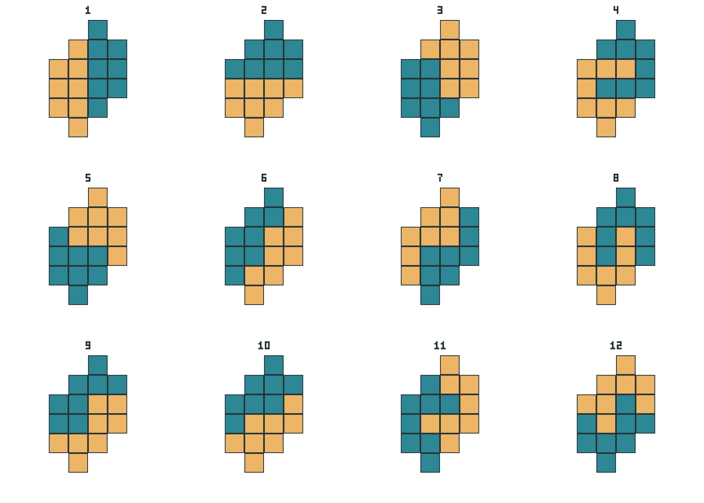

# Prime factors of polyominoes with 14 through 17 cells

A shape is a factor of a board if copies of it tile the entire board. Copies can be translated, rotated, or reflected. A prime factor has more than one square and admits no tiling by a smaller nonunit shape. The maximum counts distinct prime factors on a single connected board. [OEIS A380455](https://oeis.org/A380455)

| Board area | 14 | 15 | 16 | 17 |
| --- | ---: | ---: | ---: | ---: |
| Maximum number of distinct prime factors | 10 | 3 | 12 | 1 |

Lean proves the four equalities together. The proof includes boards attaining each value and upper bounds over every connected board of the given area. [Complete Lean theorem](../prime-polyomino-factor-maxima-14-17.lean)

## The upper bounds at 14 and 16 cells

The area of a factor divides the area of its board. If the whole board is prime, it has just one prime factor up to congruence. On a composite 14-cell board the only possible prime factor areas are 2 and 7. On a composite 16-cell board they are 2, 4, and 8. There is just one two-cell shape, the domino. Of the five four-cell shapes, only the T tetromino is prime.

A factor with half the board's area tiles it in exactly two copies. The board is connected, so some cell of one copy shares an edge with the other. Fix the first copy, move each of the eight orientations of the second into all such positions, and discard overlaps. This generates every board having that factor. The factor catalogue itself is exhaustive because every finite connected shape can be grown from one cell by adjoining edge-neighbors.

* **14 cells.** At most nine distinct seven-cell shapes can tile one board. The domino adds at most one factor. Three board classes attain ten.
* **16 cells.** All but one board class admit at most ten prime eight-cell factors. The domino and T can add at most two. The exceptional board admits twelve prime eight-cell factors and neither of the two smaller shapes.

The Lean proof bounds the number of factors by checking every admissible placement of the 108 prime seven-cell shapes and the 145 candidate prime eight-cell shapes. Placements from different factors of the same board have the same rotation- and translation-invariant key. Every large factor must belong to a checked finite list for that key. A bounded list still gives a valid upper bound when two keys share a table bucket.

A separate Python enumeration gives the exact counts of maximizing classes, with reflections identified. Run `python3 -I check.py` in this directory. Use `python3 -I check.py --json` for the occupied cells, factor identifiers, and histograms. The checker builds its catalogue from a single square and uses only the Python standard library.

| Area | Board classes with a prime half-area factor | Classes attaining the maximum |
| --- | ---: | ---: |
| 14 | 7,651 | 3 |
| 16 | 12,829 | 1 |

Each panel shows the same 16-cell board. The two colors are congruent copies of one prime octomino. Each panel uses a different octomino up to rotations and reflections.

The Lean sources use Lean 4.33.1 and Mathlib revision `0df444a360eaa60ab8c11dca51a86af692955474`. With a project using that toolchain and Mathlib cache, `python3 verify_lean.py /path/to/project` rebuilds the proof modules in dependency order in a temporary directory and audits the four-part theorem. [Pinned Formal Conjectures project](https://github.com/google-deepmind/formal-conjectures/tree/9097e2f90e66)
